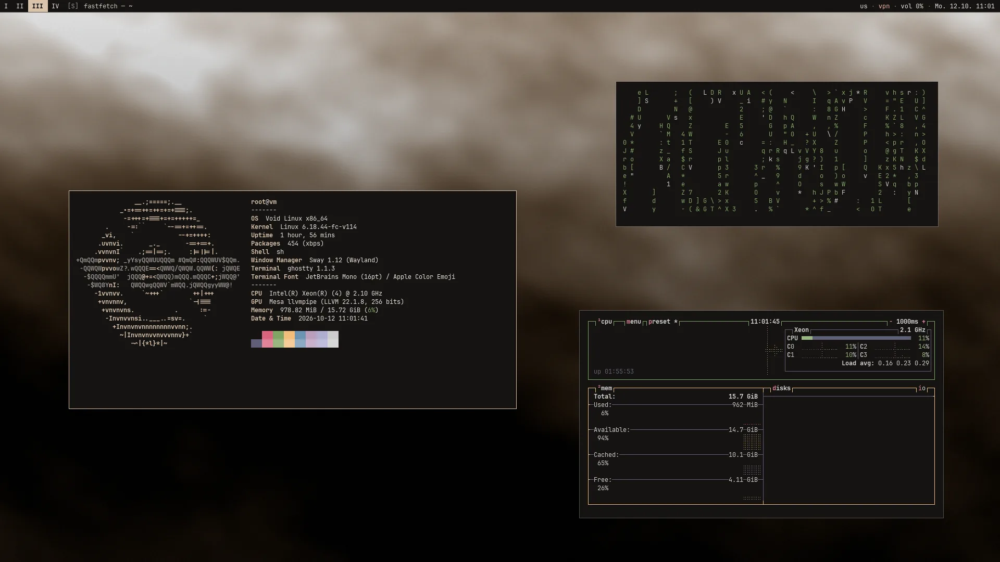
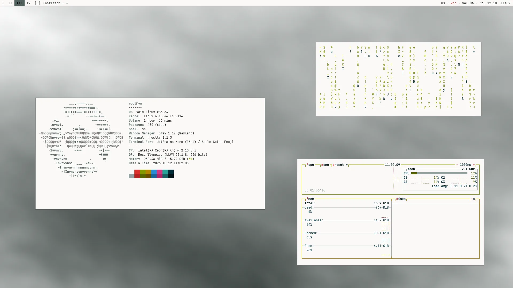
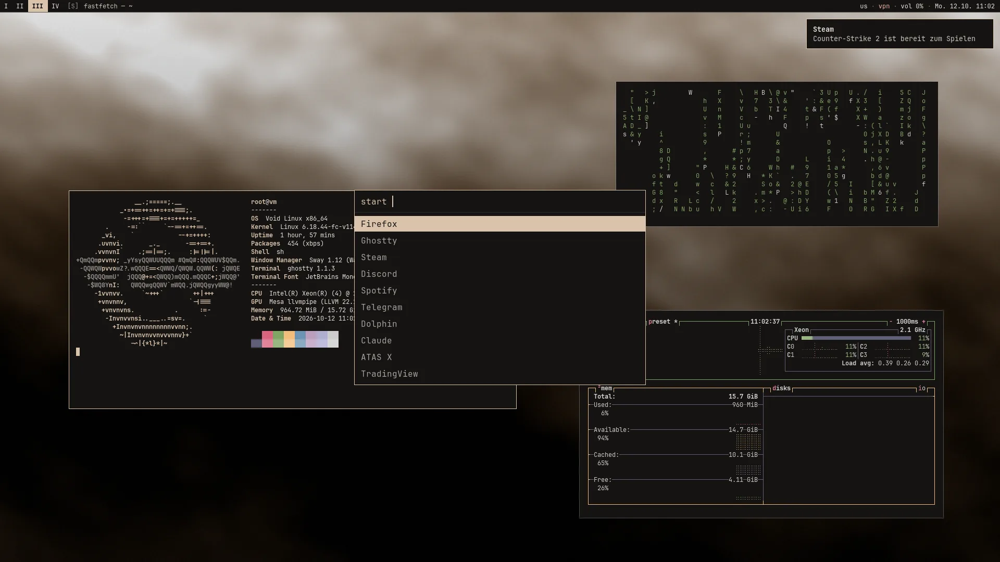

# void · mango

**Void Linux + MangoWC** auf dem Gigabyte G5 KF. Minimal, schnell, fürs Spielen
gebaut. Die Farben kommen aus dem Wallpaper.

<p align="center">
  
</p>

Dieselben Apps und Einstellungen wie das NixOS-Setup in [`linux/nix`](../nix),
nur auf Void (runit statt systemd) und mit einem anderen Stil: eckige Fenster,
1px-Rahmen, keine Effekte, eine schmale Textleiste. Das Wallpaper ist die
einzige Deko.

|  |  |
|---|---|
| **Fenstermanager** | [MangoWC](https://github.com/mangowm/mango): wie dwm (Tags, Layouts), dazu Scrollen wie Niri |
| **Login** | ly mit Schwarzem-Loch-Animation |
| **Leiste** | Text statt Symbole: Tags `I II III`, Fenstertitel, `us · vpn · vol 40% · Mo. 12.10. 11:40` |
| **Terminal** | Ghostty mit fastfetch (großes Void-Logo), cmatrix, btop |
| **Farben** | matugen: Rahmen, Leiste, Terminal, Rofi, Benachrichtigungen, Sperrbildschirm, Firefox, Discord, Spotify folgen dem Wallpaper. Hell oder dunkel |
| **Kernel** | nur einer: `linux-mainline`, der neueste (wie bei Arch) |
| **Hardware** | i5-12500H + RTX 4060 Laptop, eDP-1 1080p@144 Hz, LG 1440p@180 Hz (DP-2) |

## So sieht es aus

<table>
  <tr>
    <td width="50%"></td>
    <td width="50%"></td>
  </tr>
  <tr>
    <td align="center"><sub>hell: <code>theme -m light</code>, die Farben kommen aus demselben Wallpaper</sub></td>
    <td align="center"><sub>Starter (<code>super + space</code>) und Benachrichtigung</sub></td>
  </tr>
</table>

<sub>Die Screenshots stammen aus einer Testumgebung ohne GPU: Sway mit Software-Rendering und denselben Rahmen, Abständen und Farben wie MangoWC, die Leiste mit Beispiel-Tags. Deshalb zeigt fastfetch „vm“, Sway und eine Xeon-CPU. Die Wallpaper sind erzeugter Nebel. Die Farben hat matugen genau so daraus berechnet wie `theme.sh` auf dem Laptop.</sub>

## Installation

> **Erst ausprobieren?** [DUALBOOT.md](DUALBOOT.md): Void neben NixOS
> installieren, testen, Spiele und Daten aus NixOS holen und NixOS danach
> entfernen. `setup.sh` trägt NixOS dabei selbst ins Boot-Menü ein.


**1. Void installieren**

ISO `void-live-x86_64-*-base.iso` mit **glibc** (nicht musl, NVIDIA und Steam
laufen nur mit glibc). Im Installer (`sudo void-installer`):

- Benutzer `flask`, Gruppe `wheel`
- Bootloader GRUB (EFI)
- Netzwerk per DHCP bzw. WLAN

Plattenverschlüsselung richtet der Installer nicht selbst ein. Wer sie will,
macht LUKS vorher von Hand (Void-Handbuch, „Full Disk Encryption“).

**2. Repo holen und einrichten**

Nach dem ersten Start als `flask`:

```sh
sudo xbps-install -Su xbps git
git clone https://github.com/notflask/.config ~/dotfiles
cd ~/dotfiles && git checkout void-mango
sudo linux/void/setup.sh
```

Das dauert eine Weile: über 900 Pakete aus den Void-Repos, dazu baut
`xbps-src` die Pakete, die Void nicht hat (Claude Desktop, ATAS X, ly,
Discord, Spotify …).

**3. Neu starten**

ly fragt nach dem Passwort und startet MangoWC. WLAN danach mit `nmtui`
verbinden (NetworkManager ersetzt dhcpcd/wpa_supplicant).

**4. Einmal einrichten**

| Was | Wie |
|---|---|
| Wallpaper | Waypaper öffnen und ein dunkles, stimmungsvolles Foto wählen. Die Farben ziehen überall mit |
| VPN | `vpn import ~/Downloads/xyz.conf Name` |
| Discord | einmal starten (lädt die App nach), dann `sudo ~/dotfiles/linux/void/setup.sh custom`, das installiert Vencord |
| Spotify | einmal starten und anmelden, dann `spicetify-setup` |
| Roblox | `flatpak install --user flathub org.vinegarhq.Sober`, dann `sober-setup` |

## Alltag

Void aktualisiert man normal mit `xbps-install -Su`. Hier kommen zwei Dinge
dazu: Die eigenen Pakete baut `xbps-src` neu, und die Configs aus dem Repo
landen per `setup.sh` in `/etc`. Deshalb gibt es drei Befehle:

| Befehl | |
|---|---|
| `update` | alles: Void-Pakete, eigene Pakete, Configs, Flatpak, Spicetify |
| `apply` | nur die Configs aus dem Repo anwenden, ohne Pakete zu bauen |
| `sudo xbps-install -Su` | nur die Void-Pakete |

Und sonst:

| Befehl | |
|---|---|
| `theme`, `theme -m light`, `theme -T` | Farben neu erzeugen, hell, umschalten |
| `vpn status · up · down · lock · unlock` | VPN mit Kill-Switch |
| `novpn BEFEHL`, `vpn-split` | am VPN vorbei (Steam: `novpn gaming-mode %command%`) |
| `gaming-mode %command%` | Steam-Startoption: GameMode, MangoHud, Lüfterkurve |
| `nvidia-offload BEFEHL`, `gpu-info` | Programm auf der RTX 4060, welcher Anschluss an welcher GPU |
| `sudo sv status /var/service/*` | Dienste (statt `systemctl status`) |
| `sudo svlogtail` | Systemlog (statt `journalctl`) |

## Tastenkürzel

Wie in Niri, damit die Finger nichts umlernen müssen. Alle zeigt `super + shift + /`.

| Taste | |
|---|---|
| `super + t` · <code>super + `</code> | Terminal · Wegwerf-Terminal (nochmal drücken schließt) |
| `super + space` · `super + d` | Starter |
| `super + q` | Fenster schließen |
| `super + ←→↑↓` · `super + h j k l` | Fokus (oben/unten wechselt am Rand den Tag) |
| `super + ctrl + ←→↑↓` | Fenster verschieben |
| `super + 1…9` · `super + ctrl + 1…9` | Tag ansehen · Fenster auf Tag |
| `super + alt + 1…9` | Tag zusätzlich ansehen (dwm) |
| `super + n` | Layout: scroller → tile → fair → dwindle → monocle |
| `super + e` · `super + w` | alle Fenster gleich groß · Tabs |
| `super + r` · `super + − / =` | Breite durchschalten · ändern |
| `super + f` · `super + shift + f` | maximieren · Vollbild |
| `super + v` · `super + c` | schweben · zentrieren |
| `super + o` | Übersicht |
| `alt + tab` | Fensterwechsel mit Vorschau |
| `super + shift + s` · `print` | Screenshot mit Zeichnen · direkt |
| `super + ctrl + v` | Zwischenablage-Verlauf |
| `super + shift + l` · `super + shift + e` | sperren · Ausschalt-Menü |
| `super + shift + c` | MangoWC-Config neu laden |
| `alt + shift` | Tastaturbelegung wechseln: us → ru → ua → de |

## Die Leiste

```
 I  II [III] IV   [S]  fastfetch — ~                 us · vpn · vol 40% · bat 87% · Mo. 12.10. 11:40
```

- **Tags** in römischen Ziffern. Nur belegte und der aktuelle sind zu sehen.
  Klick wechselt dorthin, das Mausrad blättert
- **`[S]`** ist das Layout (S scroller, T tile, F fair, DW dwindle, M monocle), dahinter der Fenstertitel
- **Tastaturbelegung** klein: `us`, `de`, `ru`, `ua`
- **`vpn`**: grün verbunden, gelb verbindet, rot getrennt. **`vpn aus`** heißt
  Internet ohne VPN. Klick verbindet bzw. trennt
- **`vol`**: Mausrad ändert, Klick schaltet stumm, Rechtsklick öffnet pavucontrol
- **Tray** (Discord, Telegram, Control Center): Linksklick App, Rechtsklick Menü

## Stil und Farben

Alles richtet sich nach dem Wallpaper. Wechselt man es in Waypaper, erzeugt
matugen die Farben neu (`theme.sh`), und alles färbt sich sofort um:

| | |
|---|---|
| Fenster | eckig, 1px-Rahmen in der Akzentfarbe, kein Blur, keine Schatten, keine Animationen |
| Leiste | deckend, Text in JetBrains Mono |
| Terminal | Ghostty (`term`) mit der Fläche und dem Cursor aus dem Wallpaper |
| fastfetch | großes Void-Logo und Beschriftungen in der Akzentfarbe |
| Rofi | Starter, Ausschalt-Menü, Zwischenablage, Tastenkürzel: eckige Kästen |
| Benachrichtigungen, Sperrbildschirm | flach, 1px-Rahmen, Uhr direkt auf dem Wallpaper |
| ly und Textkonsole | Farben von Vague, wie unter NixOS |
| Apps | GTK (adw-gtk3) und Qt/KDE (Dolphin, Okular …) in den Farben von matugen |

Für den Look aus dem ersten Bild: zwei, drei Terminals mit `fastfetch`,
`cmatrix -b` oder `btop` schweben lassen (`super + v`) über einem
stimmungsvollen Foto.

## Gaming

| | |
|---|---|
| Steam, GE-Proton, Lutris, Sober | wie unter NixOS |
| Tearing | CS2, Dota 2, Deadlock und ARC Raiders dürfen tearen (kleinste Latenz, im Spiel VSync aus), andere Spiele nur, wenn sie es selbst wollen. Alles nur im Vollbild |
| VRR | auf dem LG nur für Spiele im Vollbild |
| Direct Scanout | ohne Effekte geht jedes Bild direkt an den Monitor |
| GameMode | renice 5 (Discord-Stream ruckelt nicht), Lüfter drehen früh hoch |
| System | scx_lavd, NTSYNC, Split-Lock-Bremse aus, `preempt=full`, Watchdogs aus, zram, BBR |
| Leistungsgrenzen | CPU 65 W Dauerleistung, GPU-Mindesttakt, Energieprofil „Leistung“ |
| Aufnahme | GPU Screen Recorder, `alt + z` wie ShadowPlay |

**Gegenüber NixOS mit Hyprland** (erwartet, nicht gemessen): FPS etwa gleich
(gleicher Treiber, gleiche Tweaks), der Desktop fühlt sich schneller an (keine
Animationen), das System ist etwas schlanker (runit, weniger Dienste). Messen
mit MangoHud: dasselbe Spiel an derselben Stelle, FPS und 1%-Lows vergleichen.

## Anders als unter NixOS

| NixOS | Void |
|---|---|
| Niri / Hyprland | MangoWC |
| Glas-Look, Windows-Taskleiste unten | minimal: eckig, 1px, Textleiste oben |
| hyprlock / hypridle | gtklock / swayidle, gleiche Zeiten |
| systemd | runit (`sv/`), Programme der Sitzung in `wm autostart` |
| Rollback auf ältere Generationen | **gibt es nicht**. Springt der Kernel auf eine neue Version, bleibt die alte im Boot-Menü, bis die neue einmal gestartet ist |
| Pakete aus nixpkgs | Void-Repos + `srcpkgs/` (xbps-src) + pipx/cargo |
| VPN-Fenster mit Split-Tunneling | `vpn-split` und `novpn` im Terminal |
| Startmenü, Fenster-Vorschau | Rofi, Alt+Tab von MangoWC |

Nicht übernommen: **Antigravity CLI** (`agy`), dafür gibt es kein Void-Paket.

## Aufbau

```
linux/void/
├── setup.sh            einrichten bzw. auf den Stand im Repo bringen
├── update.sh           Befehl `update`
├── DUALBOOT.md         Void neben NixOS: ausprobieren, Spiele holen, NixOS entfernen
├── update-sources.sh   neue Versionen von Claude Desktop, ATAS X, HaruNeko, TradingView, Warp
├── packages.txt        Pakete aus den Void-Repos (nach NixOS-Modulen sortiert)
├── srcpkgs/            eigene xbps-src-Rezepte: ly, Claude Desktop, ATAS X, Schriften …
├── sv/                 runit-Dienste: VPN, scx, Control Center, Leistung
├── sbin/               root-Helfer: Firewall, Kill-Switch, Sperre, Split-Tunneling
├── bin/                Befehle: term, apply, vpn, novpn, power-menu, mango-session …
├── etc/                nach /etc: sysctl, udev, ly, sudoers, Firefox, Schriften …
├── usr/                nach /usr: Firefox-Vorgaben, Standby-Hook
└── screenshots/
```

Die Configs in `linux/.config`, die nur Void nutzt: `mango/`,
`quickshell/minibar/` (Leiste), `rofi/flat.rasi`, `ghostty/void.ghostty`,
`gtklock/`, `swayidle/` und die matugen-Vorlagen `mango-colors.conf`,
`ghostty-theme`, `fastfetch-void.jsonc`, `mako-flat.ini`, `gtklock.css`.
Gemeinsam mit NixOS: nvim, matugen, `wm.sh` (kann Niri, Hyprland und MangoWC)
und `vpn-split.sh`.

## Wenn etwas nicht geht

| Problem | |
|---|---|
| Schwarzer Bildschirm nach dem Login | `~/.local/state/mango.log` lesen. In `bin/mango-session` testweise `WLR_DRM_DEVICES=/dev/dri/nvidia-dgpu`, bei Cursor-Fehlern `WLR_NO_HARDWARE_CURSORS=1` |
| Tearing klappt nicht | in `mango-session` `export WLR_DRM_NO_ATOMIC=1` |
| Kein Ton | `pgrep -a pipewire`, sonst neu anmelden |
| Paket baut nicht (neue Version upstream) | `linux/void/update-sources.sh NAME`, dann `sudo setup.sh custom` |
| Neuer Kernel startet nicht (z. B. NVIDIA noch nicht so weit) | GRUB, „Erweiterte Optionen“, den vorigen Kernel wählen. Er wird erst entfernt, wenn der neue einmal gelaufen ist |

> **Stand:** auf echter Hardware noch nicht gestartet. Geprüft in einem
> Void-chroot: Alle Pakete lösen sich auf, die MangoWC-Config besteht `mango -p`,
> alle Skripte bestehen shellcheck und die Rezepte `xlint`. ly, Claude
> Desktop, ATAS X und das Control Center bauen bzw. starten.
